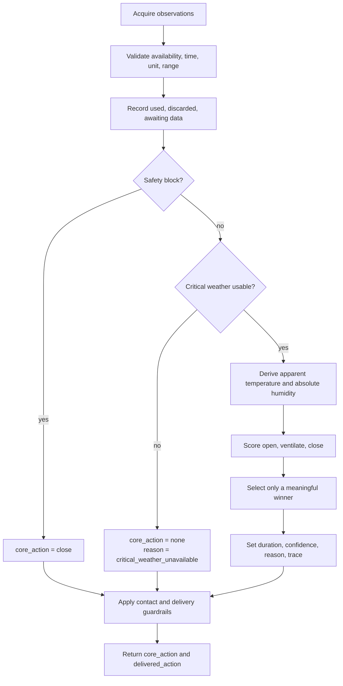
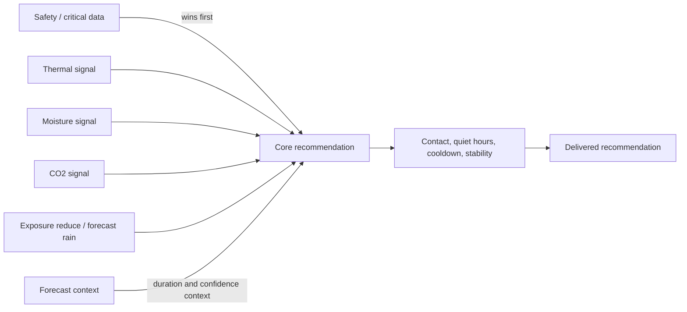

# VentWise decision-engine contract

This is the single canonical Markdown contract for the deterministic VentWise
decision engine. It describes the behavior implemented by
`custom_components/ventwise/ventwise_core/decision.py` and its data models. The
contract is normative for documentation, adapters, explanations, and focused
regression coverage.

## Purpose and non-claims

The engine evaluates each room from an immutable, source-neutral snapshot and
returns `open`, `ventilate`, `close`, or `none`. It is local, deterministic,
explainable, and advisory. Equal usable inputs, configuration, and evaluation
time produce the same result and ordered trace.

VentWise does not open or close windows, operate devices, provide a safety or
security system, protect property from weather, diagnose health conditions, or
claim regulatory compliance. CO2, humidity, temperature, pollution, and pollen
values are decision signals, not medical conclusions. A recommendation must
always be checked against actual conditions.

## Window contact semantics

Rooms persist ordered `window_contacts` rows. Each row contains an `entity_id`
and an `invert` flag. A Home Assistant `on` state is open and `off` is closed;
when `invert` is true those meanings are swapped. `unknown`, `unavailable`,
malformed, or missing states remain `unknown`.

The aggregate is `open` when any normalized contact is open, `closed` only when
all configured contacts are closed, `unknown` when no contact is open but at
least one is unknown, and `not_configured` when no contacts are configured.
Only the aggregate is passed to the pure engine: open maps to `window_open=True`,
closed to `False`, and unknown or not configured to `None`. Contact state is a
recommendation guardrail and diagnostic; it never changes the core thermal
decision. Legacy `window_sensor_entity_ids` rows are migrated to non-inverted
contacts for compatibility.

## Pipeline and precedence



The ordered rules are:

1. Validate every observation independently. Missing, invalid, future-dated,
   stale, non-finite, mixed-timezone, implausible, or wrong-unit observations
   are not used.
2. An active severe-weather condition, current precipitation, hazardous wind or
   gust, forecast severe weather/precipitation/hazardous wind, or an explicit
   pollen/pollution policy of `avoid` is a hard block. The core action is
   `close`, regardless of indoor comfort or CO2.
3. If indoor temperature is unavailable, the core action is `none` with
   `insufficient_indoor_evidence`. If outdoor temperature is unavailable, the
   core action is `none` with `critical_weather_unavailable`. If only the
   current weather condition or wind is unavailable, opening and ventilation
   candidates are blocked with `opening_weather_unavailable`, while a
   sufficiently strong thermal close may still be selected from usable indoor
   and outdoor temperatures. The engine never invents missing weather data.
4. With safety and critical-data gates passed, derive comfort and moisture
   signals, then calculate candidate scores.
5. `open`, `ventilate`, and `close` must exceed `meaningful_benefit` and beat
   the next candidate by `winner_margin`; otherwise the core action is `none`.
6. Delivery guardrails run after the core decision. A contact, quiet hours,
   cooldown, or stability gate may change only `delivered_action`; it never
   erases or changes `core_action`.



### Action meanings

| Action | Contract meaning |
| --- | --- |
| `open` | Outdoor conditions provide a meaningful sustained comfort benefit. |
| `ventilate` | A targeted or transient benefit justifies bounded airing, followed by reassessment. |
| `close` | Outdoor conditions are materially worse or a hard block is active. |
| `none` | No meaningful, sufficiently separated winner exists, or evidence is insufficient. |

`core_action` is the physical recommendation. `delivered_action` is what may be
shown after delivery suppression. A known contact can suppress duplicate advice
(`window_already_open` or `window_already_closed`) but cannot change the core
truth. Urgent safety closes bypass cooldown and stability; quiet-hours delivery
is still suppressed unless `urgent_close_during_quiet_hours` is enabled.

## Inputs, quality, and precedence table

Canonical snapshot units are °C, %, ppm, ppm/h, m/s, mm/h, and seconds. The
core expects canonical units; adapters are responsible for conversion. Each
configured numeric source has an explicit native-unit selection. When a
Home Assistant entity reports a native unit, it must match that selection;
missing or incompatible units are discarded, not silently converted or
clipped. Standard weather attributes may use their declared attribute unit;
when that attribute is absent, the weather adapter uses the canonical unit
defined by the Home Assistant weather contract.

CO2 is an indoor-only signal. Enabling CO2 requires either one global indoor
CO2 sensor or a room-level indoor CO2 sensor. The adapter converts valid
readings to ppm and records unavailable, stale, invalid, or unit-incompatible
readings as data quality rather than inferring CO2 from another signal.

| Priority | Condition | Effect | Evidence recorded |
| ---: | --- | --- | --- |
| 1 | Severe current or forecast weather | Hard close | `severe_weather` or `forecast_severe_weather` |
| 2 | Current precipitation | Hard close | `current_precipitation` |
| 3 | Current or forecast wind/gust at or above limit | Hard close | `unsafe_wind` or `forecast_unsafe_wind` |
| 4 | Pollen or pollution policy is `avoid` | Hard close | `outdoor_exposure_avoid` |
| 5 | Critical outdoor temperature missing or unusable | No decision | `critical_weather_unavailable` |
| 6 | Current weather condition or wind missing or unusable | No opening/ventilation; thermal close remains eligible | `opening_weather_unavailable` |
| 7 | Indoor temperature missing or unusable | No room decision | `insufficient_indoor_evidence` |
| 8 | `reduce` exposure policy or imminent forecast rain | Penalize candidates | `outdoor_exposure_reduce` or `imminent_rain` |
| 9 | Thermal, moisture, and CO2 signals | Score candidates | `score.thermal`, `score.moisture` |
| 10 | Contact, quiet hours, cooldown, stability | Delivery only | `delivery.suppressed` |

Outdoor humidity is optional. If it is missing or invalid, dry-bulb thermal
advice can still be evaluated, while apparent-temperature refinement and
absolute-humidity scoring are unavailable. Indoor humidity is also optional;
the engine does not invent it.

## Formulas and derived signals

### Apparent temperature

The implementation uses the heat-index polynomial only when `T >= 26.7 °C` and
`RH >= 40%`; otherwise it uses dry-bulb temperature `T`.

```text
HI = -8.784695 + 1.61139411T + 2.338549RH - 0.14611605T*RH
     - 0.012308094T^2 - 0.016424828RH^2 + 0.002211732T^2*RH
     + 0.00072546T*RH^2 - 0.000003582T^2*RH^2
```

This is not a cold-weather or wind-chill model. Wind is a safety input, not an
indoor comfort penalty.

### Magnus dew point and absolute humidity

For temperature `T` in °C and relative humidity `RH` in percent, with
`a = 17.62` and `b = 243.12 °C`:

```text
gamma = ln(RH / 100) + a*T / (b + T)
dew_point = b*gamma / (a - gamma)
saturation_pressure_hPa = 6.112 * exp(17.62*T / (243.12 + T))
absolute_humidity_g_m3 = 216.7 * (RH / 100) * saturation_pressure_hPa / (T + 273.15)
```

The moisture comparison is the effective humidity decision metric:

```text
delta_AH = AH_indoor - AH_outdoor
moisture_benefit = max(0, delta_AH)
moisture_penalty = max(0, -delta_AH)
```

Positive `delta_AH` means outdoor air can remove water vapour. Moisture becomes
a ventilation signal only when indoor RH is above the configured high limit.
Indoor RH at or below the configured low limit suppresses humidity-only
ventilation. Outdoor moisture at or above `meaningful_benefit` penalizes
opening and ventilation. Equal absolute humidity produces no moisture benefit
or penalty. Condensation is considered only when a usable indoor surface
temperature exists and indoor dew point is at or above it.

### Candidate scoring

The current implementation uses these candidate signals:

```text
indoor_distance = max(0, abs(indoor_apparent - target) - comfort_band)
outdoor_distance = max(0, abs(outdoor_apparent - target) - comfort_band)
thermal_benefit = max(0, indoor_distance - outdoor_distance)
close_score = max(0, outdoor_distance - indoor_distance)
```

`open_score` uses thermal benefit when the outdoor endpoint is within the
meaningful-benefit boundary. `ventilate_score` uses transient movement toward
the target, moisture benefit, or the CO2 signal. A high CO2 reading or positive
trend is a targeted ventilation signal, not an automatic `open` override.

## Initial thresholds and bounded behavior

These are conservative engineering defaults, not health thresholds.

| Parameter | Default | Meaning |
| --- | ---: | --- |
| Target temperature | 22 °C | Personal comfort target |
| Comfort band | 1 °C | Personal preference band |
| Humidity low / high | 40% / 60% RH | Moisture guardrails |
| Meaningful benefit | 1.0 score unit | Minimum candidate score |
| Winner margin | 0.05 score units | Required separation from next candidate |
| CO2 signal | 1000 ppm | Targeted ventilation indicator |
| CO2 trend signal | +150 ppm/h | Targeted ventilation indicator |
| Wind / gust block | 35 / 50 m/s | Opening-safety limits in current configuration |
| Imminent rain | 60% probability | Forecast safety block threshold |
| Indoor/weather freshness | 15 minutes | Default observation age limit |
| Forecast freshness | 90 minutes | Default forecast age limit |

The engine returns generic bounded duration only for `ventilate`: 15 minutes
without usable forecast temperature, 10 minutes with usable forecast
temperature, and 5 minutes when usable forecast rain probability is at least
60%. A usable surface-temperature condensation risk caps duration at 5 minutes
and multiplies confidence by 0.8. Physical room parameters never turn this
duration into an airflow or thermal prediction; complete parameters lower
confidence to 0.9 when a duration is present.

## Forecast safety

Forecast data is a near-term safety input, not an indoor-temperature predictor,
and is evaluated only after validation of its own observation, freshness,
provenance, and forecast timestamp. A complete forecast can
produce a hard block for forecast severe weather, forecast precipitation, or
forecast hazardous wind. Scalar forecast temperature and rain probability can
change duration or penalize opening. Forecast context cannot override a higher
priority safety block, create a missing value, or prove that opening is safe.

Forecasts are not weather guarantees. The trace must identify whether forecast
data was used, discarded, or awaiting its source.

## Missing, stale, invalid, and awaiting data

Every observation retains value, unit, source, observation time, receipt or
evaluation context, availability, validity, and optional freshness. The engine
records each field in one of `used`, `discarded`, or `awaiting_source`.

- `None`, `MISSING`, `INVALID`, or a non-available value is not used.
- `AWAITING_SOURCE` remains explicit; it is never replaced by a guessed value.
- A future timestamp, missing timestamp, mixed aware/naive timestamp style, or
  age beyond the lower of configured and observation freshness is discarded.
- Non-finite values and implausible values are discarded. Current plausibility
  limits include RH/rain 0–100, temperature -90–70 °C, CO2 0–10,000 ppm,
  wind/gust 0–150 m/s, and precipitation 0–500 mm/h.
- Wrong canonical units are discarded.
- Missing optional humidity removes only humidity-derived scoring.
- Missing critical weather prevents opening/ventilation; it does not invent a
  close without an active hazard.

## Result, trace, reason, confidence, and data quality

Each room result includes:

- `core_action` and `delivered_action`;
- `duration_minutes` for `ventilate`, otherwise `null`;
- candidate scores for `open`, `ventilate`, and `close`;
- a deterministic `reason_code`;
- ordered trace entries;
- `blocked_conditions` and `applied_penalties`;
- `data_quality.used`, `data_quality.discarded`, and
  `data_quality.awaiting_source`;
- confidence in the evidence and bounded model context; and
- `delivery_suppressed_by` when delivery differs from the core result.

Important reason codes include `thermal_sustained_benefit`,
`targeted_ventilation_benefit`, `co2_high`, `humidity_high`,
`outdoor_materially_worse`, `insufficient_or_tied_benefit`,
`insufficient_indoor_evidence`, `critical_weather_unavailable`, and
`opening_weather_unavailable`.

Trace codes identify configuration, data quality, blocks, penalties, derived
scores, selection, physical context, and delivery suppression. Explanations
must state both truths when delivery is suppressed: the core recommendation and
the suppression cause. Confidence decreases with discarded data and optional
physical/condensation adjustments; it is not a probability of safety or a
health assessment.

For multiple rooms, all room results remain in input order. The aggregate result
selects the best deliverable room first, then uses stable action priority
(`close`, `ventilate`, `open`, `none`) and room ID as deterministic tie-breakers.

## Scenario matrix

| Scenario | Required evidence | Expected core result | Expected delivery / explanation |
| --- | --- | --- | --- |
| Hot room, cooler outdoor air near target | Usable indoor/outdoor temperature, weather, wind | `open` | Thermal sustained benefit |
| Cold room, warmer outdoor air near target | Same | `open` | Bidirectional thermal benefit |
| Outdoor air moves toward target but is a poor endpoint | Same | `ventilate` | 15/10/5-minute bounded duration |
| High indoor CO2 or rising CO2 trend | Usable indoor CO2 or trend plus safe weather | `ventilate` | `co2_high` when level reaches 1000 ppm |
| Indoor RH above configured high limit and lower outdoor AH | Usable indoor/outdoor humidity | `ventilate` | `humidity_high`; AH delta in trace |
| Indoor RH at/below configured low limit | Usable indoor humidity and no CO2 signal | No humidity-only ventilation | `humidity.low_guardrail` |
| Equal indoor/outdoor AH | Usable indoor/outdoor humidity | Thermal/CO2 result only | No moisture benefit or penalty |
| Outdoor AH materially higher | Usable humidity and thermal data | Penalized; may be `none` or another winner | `outdoor_moisture_load` |
| Severe weather, current rain, unsafe wind/gust | Usable weather/hazard evidence | `close` | Urgent safety close; contacts only suppress duplicate closed advice |
| Forecast severe/rain/wind hazard | Usable complete forecast | `close` | Forecast block in trace |
| Pollen/pollution policy `avoid` | Valid explicit policy | `close` | `outdoor_exposure_avoid` |
| Pollen/pollution policy `reduce` | Valid explicit policy | Candidate penalty | `outdoor_exposure_reduce` |
| Missing/stale/invalid outdoor temperature | Data-quality failure | `none` | `critical_weather_unavailable` |
| Missing/stale/invalid current weather or wind | Data-quality failure | Thermal `close` may remain eligible; no opening advice | `opening_weather_unavailable` |
| Hot room with materially hotter outdoor air and unknown window state | Usable indoor/outdoor temperature; no configured contact required | `close` | `outdoor_materially_worse`; `not_configured` remains neutral |
| Missing indoor temperature | Data-quality failure | `none` | `insufficient_indoor_evidence` |
| Missing outdoor humidity only | Usable dry-bulb critical data | Thermal result remains possible | Moisture scoring is absent, not guessed |
| Neutral or tied candidates | Usable inputs | `none` | `insufficient_or_tied_benefit` |
| Quiet hours, cooldown, stability, or satisfied contact | Any actionable core result | Core preserved | Delivered action may be `none`; cause is traced |
| Condensation risk with surface temperature | Usable dew point and surface temperature | Core preserved | Duration capped at 5 minutes; confidence reduced |

## Limits and maintenance rule

The contract does not claim exact air-change time, occupancy inference, airflow
calibration, pollutant health equivalence, cold/wind-chill comfort, or forecast
certainty. Exposure readings are retained with source, unit, averaging period,
attribution, resolution, and coverage, but they do not become decision inputs
without an explicit configured policy.

When behavior or a public result field changes, update this file, the narrowest
relevant regression coverage, and any user-facing integration documentation.
Do not create a second decision-model source. CI and GitHub Pages validation
must check this Markdown file as the canonical source.
